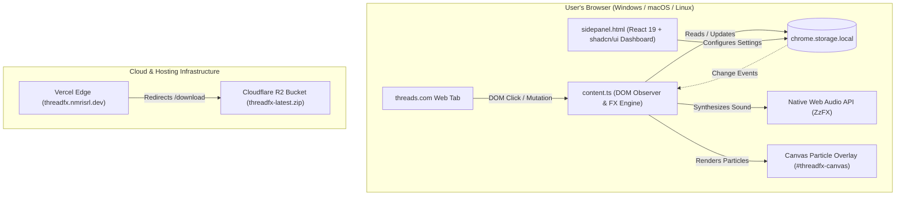
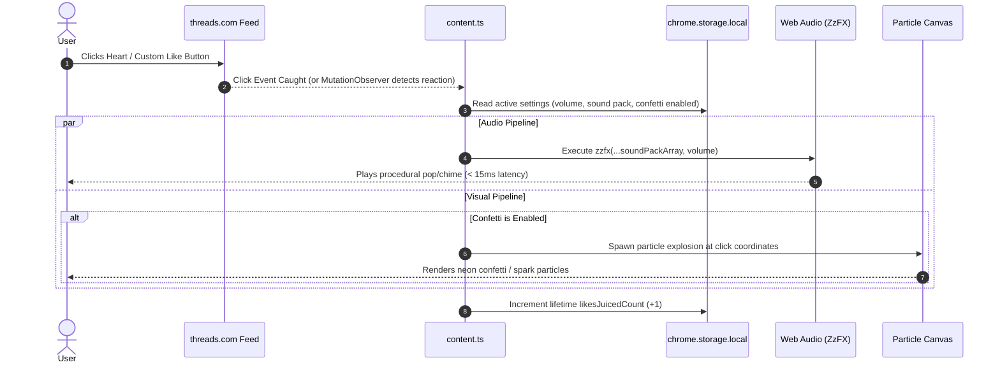

# ARCHITECTURE.md — ThreadFX Technical Architecture

> This document details the technical implementation, runtime lifecycle, audio synthesis pipeline, and infrastructure architecture for **ThreadFX**.

---

## 1. System Overview & Component Diagram

ThreadFX consists of two independent subsystems connected via Cloudflare R2 and shared TypeScript logic:



---

## 2. Like Interception & Execution Lifecycle

When a user likes a post on Threads (standard heart or custom like), the following sequence executes within **< 15 milliseconds**:



---

## 3. The Audio Synthesis Pipeline (ZzFX)

Instead of fetching network `.mp3` files or managing heavy audio elements, ThreadFX uses **in-memory procedural audio synthesis**:

1. **Parameters:** A sound is defined by an array of numbers representing audio attributes:
   `[volume, randomness, frequency, attack, sustain, decay, shape, modulation...]`
2. **Buffer Generation:** ZzFX allocates a 1-channel `AudioBuffer` directly in the browser's `AudioContext`.
3. **Waveform Computation:** A tight mathematical loop computes frequency ramps, noise, and amplitude envelopes.
4. **Playback:** The generated buffer is connected to `ctx.destination` via `AudioBufferSourceNode` and played instantly.
5. **Memory Footprint:** The entire synthesis engine is `< 1 KB`, runs in `< 5ms`, and generates zero garbage collection pauses.

---

## 4. Side Panel Architecture (`chrome.sidePanel`)

Rather than an ephemeral popup dropdown, ThreadFX operates inside Chrome's native **Side Panel**:

* **Lifecycle:** Stays open and docked to the right side of the screen as the user navigates across Threads profiles, replies, and feeds.
* **Launch Trigger:**
  ```typescript
  // extension/entrypoints/background.ts
  chrome.sidePanel.setPanelBehavior({ openPanelOnActionClick: true });
  ```
* **State Synchronization:**
  * When a user changes volume or toggles confetti in the Side Panel, it calls `chrome.storage.local.set({ ... })`.
  * `content.ts` listens to `chrome.storage.onChanged` and updates its in-memory settings cache without requiring any reload.

---

## 5. Resilient DOM Detection Strategy

To prevent Meta's minified class rotations from breaking the extension:

1. **Top-Level Event Delegation:** `content.ts` listens to `document.body` for `click` events rather than attaching individual listeners to every post.
2. **Semantic Target Resolution:**
   ```typescript
   function isLikeButton(target: HTMLElement): boolean {
     const button = target.closest('[role="button"]');
     if (!button) return false;
     const ariaLabel = button.getAttribute('aria-label') || '';
     return /like/i.test(ariaLabel);
   }
   ```
3. **Custom Like Observer:**
   A `MutationObserver` watches `main[role="main"]` specifically for newly inserted image overlays (`img[src*="giphy"]`, animated SVGs, or custom sticker nodes) that pop up directly over the heart button when a custom like triggers.

---

## 6. Cross-OS & Multi-Platform Architecture

* **OS Independence:** The core extension code interacts purely with standard W3C Web Audio API and Chrome Extension MV3 APIs, ensuring byte-for-byte identical audio synthesis across:
  * **Windows:** DirectSound / WASAPI audio pipeline via browser.
  * **macOS:** CoreAudio low-latency pipeline via browser.
  * **Linux:** PulseAudio / PipeWire audio pipeline via browser.
* **Future Targets (Planned):**
  * **Safari Web Extension:** Converting via Xcode tools for native macOS Safari support.
  * **Firefox Target:** Supporting Gecko engines via WXT cross-compilation.

---

## 7. Distribution & Domain Infrastructure

### Multi-Domain Vercel Fallback
```text
https://threadfx.nmrisrl.dev (Public Branded URL)
          │
          ▼
   Vercel Deployment (threadfx.vercel.app)
          │
          ├──> / (Landing page, interactive audio demo)
          │
          └──> /download ──(307 Redirect)──> Cloudflare R2 (threadfx-latest.zip)
```

* **Resilience:** If `threadfx.nmrisrl.dev` DNS is ever altered or disconnected, `threadfx.vercel.app` automatically serves as the working primary site with zero downtime.
* **Bandwidth Optimization:** The extension `.zip` download is offloaded completely to **Cloudflare R2** with **$0 egress fees**, protecting Vercel bandwidth limits from viral traffic spikes.
