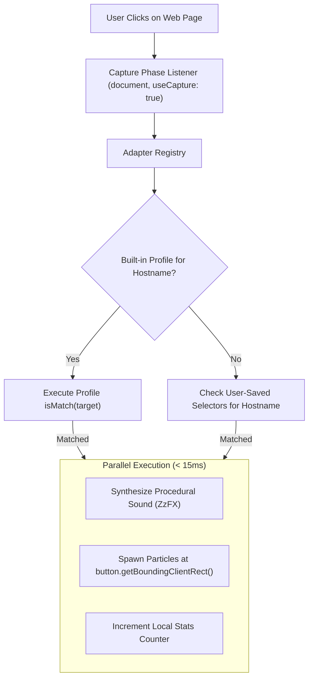
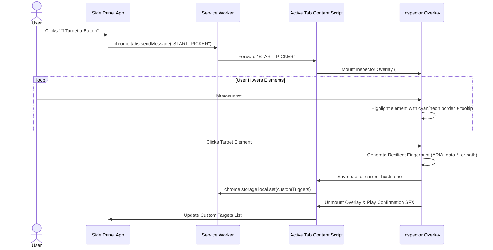

# UNIVERSAL_FX_ROADMAP.md — Headless & Multi-Platform FX Architecture

> **Specification & Future Migration Guide**  
> This document defines the architectural blueprint, platform profiles, element picker engine, permissions model, and migration checklist required to evolve **ThreadFX** into a universal, multi-platform tactile feedback suite (supporting X, Facebook, Instagram, Bluesky, and user-targeted custom elements).

---

## 1. Executive Summary & Vision

ThreadFX was built with a clean, decoupled architecture:

- **Procedural Sound Engine (`zzfx.ts`):** 100% platform-agnostic Web Audio synthesis.
- **Visual Particle Engine (`canvas-confetti`):** 100% platform-agnostic viewport canvas.
- **State Synchronization (`storage.ts`):** Standard `chrome.storage.local` store.

Currently, only the DOM trigger in `extension/entrypoints/content.ts` is coupled to Threads.

The **Universal FX Engine** evolves this single trigger into a **Dual-Layer Interception System**:

1. **Layer 1: Built-In Platform Profiles:** Zero-configuration semantic adapters for top social platforms (X/Twitter, Facebook, Bluesky, Instagram, Reddit, YouTube, GitHub).
2. **Layer 2: Interactive Element Picker ("Click-to-Target"):** A visual inspector allowing users to click and bind any like, heart, upvote, star, or custom button on _any_ website.

---

## 2. Core Architecture: Adapter Pattern

Instead of hardcoding DOM selectors in `content.ts`, the content script operates as an **Adapter Registry**:



### Modular Directory Structure (Planned)

```text
extension/
├── lib/
│   ├── zzfx.ts                     # Audio synthesis (unchanged)
│   ├── presets.ts                  # Sound parameter arrays (unchanged)
│   ├── storage.ts                  # Schema extended with custom triggers
│   └── fx-runner.ts                # Shared executeFX(targetEl, options) helper
│
├── entrypoints/
│   ├── content.ts                  # Registry coordinator & capture listener
│   ├── picker.ts                   # Injected Element Inspector overlay
│   └── adapters/                   # Platform-specific profiles
│       ├── types.ts                # PlatformAdapter interface
│       ├── threads.ts              # Threads.com profile
│       ├── x.ts                    # X (Twitter) profile
│       ├── facebook.ts             # Facebook profile (incl. reaction flyouts)
│       ├── bluesky.ts              # Bluesky profile
│       ├── reddit.ts               # Reddit upvotes profile
│       └── github.ts               # GitHub star profile
```

---

## 3. Platform Adapter Specifications

Each platform adapter implements a standard interface:

```typescript
export interface PlatformAdapter {
	id: string;
	name: string;
	domains: string[];
	// Resilient matcher that handles nested icons, SVGs, and spans
	isTrigger: (target: HTMLElement) => {
		isMatch: boolean;
		buttonEl?: HTMLElement;
		reactionType?: string;
	};
}
```

### 1. Threads Profile (`threads.ts`)

```typescript
export const threadsAdapter: PlatformAdapter = {
	id: "threads",
	name: "Threads",
	domains: ["threads.com", "threads.net"],
	isTrigger: (target) => {
		const button =
			target.closest<HTMLElement>('[role="button"]') || target.closest<HTMLElement>("button");
		if (!button) return { isMatch: false };

		const label = (button.getAttribute("aria-label") || "").toLowerCase();
		const svg = button.querySelector("svg");
		const svgLabel = (svg?.getAttribute("aria-label") || "").toLowerCase();
		const combined = `${label} ${svgLabel}`;

		const isLike = combined.includes("like") && !combined.includes("unlike");
		const hasHeart = !!button.querySelector('svg path[d*="M12"]');

		return { isMatch: isLike || hasHeart, buttonEl: button };
	},
};
```

### 2. X / Twitter Profile (`x.ts`)

X uses clean semantic `data-testid` attributes that rarely change across builds:

```typescript
export const xAdapter: PlatformAdapter = {
	id: "x",
	name: "X (Twitter)",
	domains: ["x.com", "twitter.com"],
	isTrigger: (target) => {
		// Like button
		const likeBtn = target.closest<HTMLElement>('[data-testid="like"]');
		if (likeBtn) return { isMatch: true, buttonEl: likeBtn, reactionType: "like" };

		// Optional: Retweet / Repost
		const repostBtn = target.closest<HTMLElement>('[data-testid="retweet"]');
		if (repostBtn) return { isMatch: true, buttonEl: repostBtn, reactionType: "repost" };

		// Optional: Bookmark
		const bookmarkBtn = target.closest<HTMLElement>('[data-testid="bookmark"]');
		if (bookmarkBtn) return { isMatch: true, buttonEl: bookmarkBtn, reactionType: "bookmark" };

		return { isMatch: false };
	},
};
```

### 3. Facebook Profile (`facebook.ts`)

Facebook features two interaction modes: direct like click and hover reaction dock:

```typescript
export const facebookAdapter: PlatformAdapter = {
	id: "facebook",
	name: "Facebook",
	domains: ["facebook.com"],
	isTrigger: (target) => {
		// 1. Hover Reaction Flyout Dock (Love, Haha, Wow, Sad, Angry)
		const reactionItem = target.closest<HTMLElement>('[role="toolbar"] [role="button"]');
		if (reactionItem) {
			const label = (reactionItem.getAttribute("aria-label") || "").toLowerCase();
			return { isMatch: true, buttonEl: reactionItem, reactionType: label || "reaction" };
		}

		// 2. Direct Like / React Button on Post
		const actionBtn = target.closest<HTMLElement>('div[role="button"]:has(span)');
		if (actionBtn) {
			const label = (
				actionBtn.getAttribute("aria-label") ||
				actionBtn.innerText ||
				""
			).toLowerCase();
			if (label.includes("like") || label.includes("react")) {
				return { isMatch: true, buttonEl: actionBtn, reactionType: "like" };
			}
		}

		return { isMatch: false };
	},
};
```

### 4. Bluesky Profile (`bluesky.ts`)

Bluesky uses explicit test IDs and ARIA labels:

```typescript
export const blueskyAdapter: PlatformAdapter = {
	id: "bluesky",
	name: "Bluesky",
	domains: ["bsky.app"],
	isTrigger: (target) => {
		const likeBtn = target.closest<HTMLElement>('[data-testid="likeBtn"]');
		if (likeBtn) return { isMatch: true, buttonEl: likeBtn, reactionType: "like" };

		const repostBtn = target.closest<HTMLElement>('[data-testid="repostBtn"]');
		if (repostBtn) return { isMatch: true, buttonEl: repostBtn, reactionType: "repost" };

		return { isMatch: false };
	},
};
```

### 5. GitHub Stars Profile (`github.ts`)

```typescript
export const githubAdapter: PlatformAdapter = {
	id: "github",
	name: "GitHub",
	domains: ["github.com"],
	isTrigger: (target) => {
		const starBtn = target.closest<HTMLElement>('.js-toggler-target[aria-label*="Star"]');
		if (starBtn) return { isMatch: true, buttonEl: starBtn, reactionType: "star" };
		return { isMatch: false };
	},
};
```

---

## 4. The "Click-to-Target" Element Picker Engine

For any unlisted website or custom button, users can enter an interactive inspector mode directly from the Side Panel:



### Resilient Selector Fingerprinting Algorithm:

When capturing an element, the picker evaluates identifiers in priority order:

1. **`data-testid` / `data-test` / `data-id`:** e.g., `[data-testid="like"]` (99% stable across updates).
2. **Semantic Role + ARIA Label:** e.g., `[role="button"][aria-label*="Like" i]` (resists obfuscated class rotations).
3. **Dedicated Action Attributes:** e.g., `button[name="like"]`, `input[type="submit"]`.
4. **Structural Fallback:** Nearest parent ID + unique tag hierarchy (avoiding dynamic hashes like `.css-19zjgq`).

---

## 5. Permissions & Chrome Web Store Compliance (MV3)

A major hurdle for multi-site extensions is user trust. If we declare `<all_urls>` upfront, Chrome displays:

> _"Warning: Can read and change all your data on all websites."_

### The Solution: Dynamic Optional Permissions (`chrome.permissions.request`)

1. **Default Base Manifest:** Keeps `host_permissions` strictly minimal:
   ```json
   "host_permissions": [
     "https://*.threads.com/*",
     "https://threads.com/*",
     "https://*.threads.net/*",
     "https://threads.net/*"
   ]
   ```
2. **On-Demand Permission Requests:** When the user toggles "Enable on X" or clicks "Target a Button" on a new site, the Side Panel requests permission for _only that specific domain_:
   ```typescript
   export async function requestDomainPermission(domain: string): Promise<boolean> {
   	const granted = await chrome.permissions.request({
   		origins: [`https://*.${domain}/*`, `https://${domain}/*`],
   	});
   	return granted;
   }
   ```
3. **Dynamic Content Script Registration:** For user-targeted custom sites, register the content script at runtime without needing store updates:
   ```typescript
   await chrome.scripting.registerContentScripts([
   	{
   		id: `threadfx-${domain.replace(/\./g, "-")}`,
   		matches: [`https://*.${domain}/*`, `https://${domain}/*`],
   		js: ["content-scripts/content.js"],
   		runAt: "document_idle",
   	},
   ]);
   ```

---

## 6. Extended Storage Schema

To support multiple platforms and user-defined targets without breaking existing user data, extend the schema incrementally:

```typescript
export interface CustomTargetRule {
	id: string; // Unique UUID
	name: string; // Human-readable label (e.g. "GitHub Star")
	domain: string; // e.g. "github.com"
	selector: string; // CSS selector
	soundPack?: "bubble" | "retro" | "hype" | "blip"; // Optional custom pack override
	confettiEnabled?: boolean; // Optional confetti toggle override
}

export interface PlatformConfig {
	enabled: boolean;
	soundPack?: "bubble" | "retro" | "hype" | "blip";
}

export interface ThreadFXSettingsV2 extends ThreadFXSettings {
	// Built-in platforms toggles
	platforms: {
		threads: PlatformConfig;
		x: PlatformConfig;
		facebook: PlatformConfig;
		bluesky: PlatformConfig;
		reddit: PlatformConfig;
	};
	// User-defined targets
	customTargets: CustomTargetRule[];
}
```

---

## 7. Brand & Identity Evolution Strategy

If expanding beyond Threads, there are three practical paths:

### Path A: Keep "ThreadFX" (Recommended)

- **The "Social Thread" Narrative:** "Thread" is universal across social media—X threads, Reddit threads, Bluesky threads.
- **Tagline:** _"ThreadFX — Satisfying tactile audio and visual particle reactions across the social web."_
- **Advantage:** Preserves your established branding, 3D emblem, and existing user base.

### Path B: Product Family Sub-Branding

- Retain `ThreadFX` for the flagship Threads experience.
- Introduce `ThreadFX Universal` or `ThreadFX for X` as companion modes within the same unified extension.

### Path C: Full Rebrand (If Ever Desired)

If you ever decide to adopt a universal name (e.g. `JuiceFX` or `TactileFX`):

1. **GitHub:** Rename repository in Settings (GitHub maintains automatic permanent redirects for clone/fetch/stars).
2. **Package Workspaces:** Update `name` in `package.json`, `extension/package.json`, and `website/package.json`.
3. **Manifest:** Update `name` and `short_name` in `wxt.config.ts`.
4. **Domain:** Point new domain to Vercel and configure 301 redirects from `threadfx.nmrisrl.dev`.
5. **Assets:** Swap emblem artwork and update `BRAND.md`.

---

## 8. Step-by-Step Implementation Checklist

When you are ready to implement this roadmap, execute in this order:

- [ ] **Step 1: Refactor `content.ts` into Adapter Registry**
  - Extract the current Threads matcher into `extension/entrypoints/adapters/threads.ts`.
  - Create a generic runner in `extension/entrypoints/content.ts` that loops over active adapters.
- [ ] **Step 2: Add X (Twitter) Profile**
  - Author `extension/entrypoints/adapters/x.ts` targeting `[data-testid="like"]`.
  - Add `x.com` to optional permissions.
- [ ] **Step 3: Update Side Panel UI**
  - Add a **"Platforms"** tab or accordion in the Side Panel with toggles for Threads and X.
  - Wire permission requests to the toggle switch.
- [ ] **Step 4: Build the Interactive Element Inspector (`picker.ts`)**
  - Implement the hover highlight and click listener.
  - Build the selector generation function.
  - Store captured rules in `chrome.storage.local`.
- [ ] **Step 5: Add Facebook Profile (Complex Reactions)**
  - Author `extension/entrypoints/adapters/facebook.ts`.
  - Handle hover reaction menu coordinates so particles burst from the specific emoji chosen.
- [ ] **Step 6: Release as ThreadFX v2.0**
  - Bump version, author consumer release notes, update marketing website.
