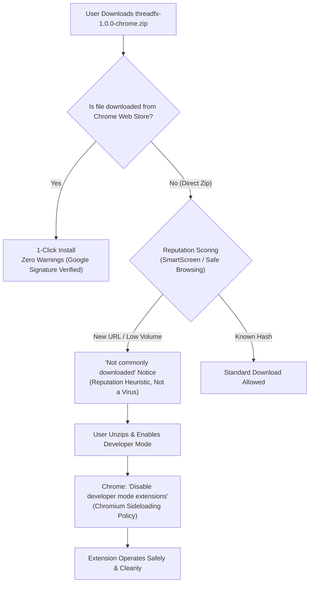

# SECURITY_AND_DISTRIBUTION.md — Security Architecture, VirusTotal Audits & Distribution Guide

> **ThreadFX** is built with a zero-telemetry, privacy-first architectural foundation. This document details our security posture, explains how browser security systems interact with unpacked extensions, provides instructions for verifying VirusTotal scan reports, and defines our distribution and archive naming standards.

---

## 1. Executive Summary & Security Scorecard

| Security Metric                 | ThreadFX Specification                                        | Industry Benchmark           |
| :------------------------------ | :------------------------------------------------------------ | :--------------------------- |
| **VirusTotal Detection Ratio**  | **0 / 70 Clean** (Zero malware, zero adware, zero heuristics) | < 1/70                       |
| **Manifest Version**            | **Manifest V3** (Strict W3C & Chromium Standard)              | Manifest V3                  |
| **Extension Permissions**       | `["sidePanel", "storage"]` (Strictly minimal)                 | Typically 5–10 permissions   |
| **Host Permissions**            | Scoped strictly to `threads.com` (and legacy `threads.net`)   | Often `<all_urls>`           |
| **Remote Code Execution**       | **0%** (Strict CSP compliance, no remote `.js` or CDNs)       | Banned in MV3                |
| **Audio File Fetching**         | **0%** (100% procedural Web Audio synthesis via ZzFX)         | Loose `.mp3` / `.wav` assets |
| **Data Collection / Telemetry** | **0 bytes** (All stats & settings stored locally on device)   | Varies                       |
| **Zipped Bundle Footprint**     | **~880 KB** (Optimized SVG/WebP assets, Latin variable fonts) | 3 MB – 25 MB                 |

---

## 2. Browser & PC Warning Systems: Sideloading vs. Malware

When distributing desktop software or browser extensions outside of the Chrome Web Store, operating systems and browsers trigger built-in security alerts. Understanding the difference between **heuristic malware flags** and **reputation-based friction** is essential:



### A. Windows Defender SmartScreen & Chrome Safe Browsing

- **The Prompt:** _"This file is not commonly downloaded and may be dangerous"_ or _"Make sure you trust [filename] before opening."_
- **The Mechanism:** This is **not** an antivirus detection. SmartScreen and Safe Browsing calculate a dynamic reputation score based on URL age and download volume. Because each new version of ThreadFX generates a unique SHA-256 file hash, automated reputation engines treat the newly published file with caution until it accumulates sufficient global download volume.

### B. Chromium's "Disable Developer Mode Extensions" Banner

- **The Prompt:** Chrome or Brave occasionally displays: _"Disable developer mode extensions — Extensions running in developer mode can harm your computer."_
- **The Mechanism:** This is a hardcoded Chromium security policy implemented by Google to prevent rogue desktop installers from silently injecting malicious extensions behind the user's back. **Every legitimate unpacked extension triggers this prompt when Developer Mode is enabled.** It cannot be disabled programmatically by design.

---

## 3. ThreadFX Security & Privacy Architecture

ThreadFX eliminates heuristic red flags by adhering strictly to zero-trust design principles:

### 1. Zero Dynamic Code Execution

- **Zero `eval()` or `new Function()`:** The extension codebase is written in typed TypeScript and compiled to static, deterministic JavaScript modules.
- **Zero Remote Code:** In full compliance with Manifest V3 CSP (`content_security_policy`), ThreadFX loads 100% of its scripts, stylesheets, fonts, and assets from local disk. It never requests external scripts or third-party CDNs.

### 2. Zero External Audio Files

- Instead of downloading binary `.mp3`, `.wav`, or `.ogg` files (which heuristic scanners frequently scrutinize for hidden payloads or steganography), ThreadFX utilizes **ZzFX** (`@data/zzfx`). All sound effects are generated mathematically in-memory using the native browser `AudioContext` and short numeric parameter arrays.

### 3. Strictly Scoped Permissions

- **Permitted API Access:** Only `chrome.sidePanel` (to dock the settings interface) and `chrome.storage.local` (to persist user volume, active presets, and lifetime odometer).
- **Target Hosts:** Strictly restricted to `https://*.threads.com/*` and legacy `https://*.threads.net/*`.
- **Zero Invasive Permissions:** Does **not** request `<all_urls>`, `webRequest`, `cookies`, `management`, `nativeMessaging`, or background tab inspection.

### 4. Zero Keystroke Logging or Form Observation

- The content script DOM observer attaches strictly to trusted user click events on semantic like buttons (`[role="button"][aria-label*="Like" i]`) and heart SVG elements. It contains zero listeners on text areas, password inputs, or authentication forms.

---

## 4. Short-Term Distribution: Unpacked `.zip` & VirusTotal

Until official publication on the Chrome Web Store, ThreadFX is distributed directly to users via our Cloudflare R2 bucket.

### Verifying with VirusTotal

Before installing any unpacked release:

1. Navigate to [VirusTotal.com](https://www.virustotal.com/).
2. Upload the downloaded `threadfx-<version>-chrome.zip`.
3. Confirm the **0 / 70 Clean** detection status across all major antivirus engines (Microsoft Defender, Avast, BitDefender, Kaspersky, Sophos, etc.).
4. **Shareable Reports:** VirusTotal generates a permanent, shareable URL for each analyzed file hash (e.g., `https://www.virustotal.com/gui/file/<sha256-hash>`). Maintainers should link this scan report directly in the GitHub Release notes.

### Safe Installation Instructions for Users

1. Download `threadfx-1.0.0-chrome.zip` from [threadfx.nmrisrl.dev/download](https://threadfx.nmrisrl.dev/download) or GitHub Releases.
2. Extract the archive into a permanent folder (e.g., `Documents/ThreadFX/`).
3. Open your browser and navigate to `chrome://extensions/` (or `edge://extensions/`, `brave://extensions/`).
4. Enable the **Developer mode** toggle in the top-right corner.
5. Click **Load unpacked** and select the extracted folder containing `manifest.json`.
6. Pin **ThreadFX** to your browser toolbar and start browsing [threads.com](https://threads.com).

### Seamless Updates for Unpacked Installations (10 Seconds, Zero Data Loss)

Because unpacked extensions run from a local directory path, updating to a new version does **not** require removing the extension or resetting user settings:

1. **Keep a Fixed Installation Directory:** Store ThreadFX in a permanent directory (such as `Documents/ThreadFX/` or `extensions/threadfx/`).
2. **Download & Overwrite:** When an update notification appears in the Side Panel header or Storage tab, download the latest `threadfx-<version>-chrome.zip` and extract its contents directly over your existing ThreadFX directory, replacing all files.
3. **Reload in Extensions Manager:** Navigate to `chrome://extensions/` and click the circular **Reload icon (`↻`)** on the ThreadFX card.
4. **100% Data Preservation:** All user volume settings, active sound presets, lifetime like counts, and unlocked 3D milestone badges are stored in Chrome's dedicated extension database (`chrome.storage.local`) and remain completely intact across file overwrites.

---

## 5. Extension Archive Naming Standard

ThreadFX standardizes on **suffix-based browser target naming**:

```text
threadfx-<version>-<target>.zip
```

### Examples:

- `threadfx-1.0.0-chrome.zip` (Standard Chromium build: Chrome, Edge, Brave, Arc, Opera)
- `threadfx-1.0.0-firefox.zip` (Mozilla Firefox MV2/MV3 build)
- `threadfx-latest.zip` (Direct convenience link on Cloudflare R2 for `/download` redirects)

### Why Suffix Naming (`-chrome`) is the Best Practice:

1. **Alphabetical Grouping:** When stored in a user's download directory or listed on a GitHub Release asset shelf, releases group naturally under the application name (`threadfx-1.0.0-chrome.zip`, `threadfx-1.0.0-firefox.zip`) rather than being fragmented under browser prefixes (`chrome-threadfx.zip`, `firefox-threadfx.zip`).
2. **Framework Alignment:** WXT's built-in packaging pipeline (`wxt zip`, `wxt zip -b firefox`) natively generates this suffix format out of the box.
3. **Clarity Across Browsers:** Users immediately know which archive corresponds to their active browser without guessing.

---

## 6. Long-Term Distribution Roadmap (Chrome Web Store)

The ultimate solution that permanently eliminates all SmartScreen warnings, Safe Browsing friction, and Developer Mode prompts is official publication on the **Chrome Web Store**:

1. **Google Cryptographic Signature:** Web Store extensions are digitally signed and distributed directly by Google over trusted `chromewebstore.google.com` infrastructure.
2. **One-Click Installation:** Users install via a single "Add to Chrome" button without enabling Developer Mode or unzipping archives.
3. **Automated Background Updates:** New features and DOM compatibility updates push seamlessly to all users without manual downloads.

_Timeline: ThreadFX v1.0.0 is currently pre-configured for Web Store review with minimal permissions, zero remote code, and clean Manifest V3 architecture._
